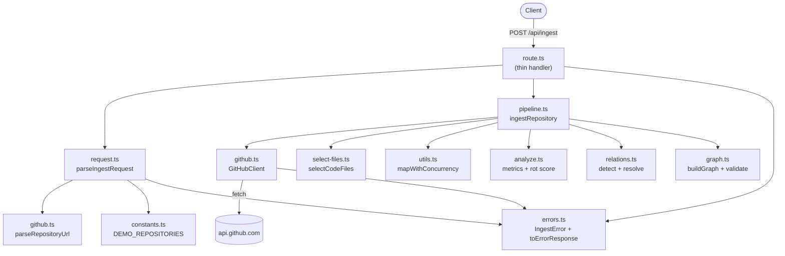

# Design Document

## Overview

`POST /api/ingest` accepts a GitHub repository URL (or a demo preset id), reads the repository through the GitHub REST API without cloning, and returns a graph-ready result: one node per analyzed code file (with a code-rot score and metrics) and one edge per resolved import relationship.

The design splits the feature into a thin Next.js route handler and a set of small, mostly pure modules under `src/lib/ingest/`. Everything that touches the network is behind one injectable `GitHubClient`, so the rest of the pipeline can be tested with plain data and without network access.

### Goals

- Satisfy Requirements 1–15 with the fewest moving parts: standard `fetch`, `node:path/posix`, and regexes. No new runtime dependencies.
- Keep logic pure and deterministic (time and I/O are injected) so it can be covered by property-based tests.
- Follow the steering conventions: shared types in `src/lib/types.ts`, constants in `src/lib/constants.ts`, utilities in `src/lib/utils.ts`, and the `ApiResponse<T>` envelope.

### Non-Goals

- Persisting results, caching analyses, or authenticating callers of `/api/ingest`.
- Resolving TS path aliases (`@/…`), `node_modules` packages, or Python third-party packages.
- Converting `IngestNode`/`IngestEdge` to React Flow nodes. That belongs to the graph store/transformer feature.

### Next.js 16 conventions applied (from `node_modules/next/dist/docs/`)

`AGENTS.md` warns that this Next.js version differs from older releases, so the route follows the bundled docs rather than memory:

| Topic | What the local docs say | Consequence for this design | Source |
| --- | --- | --- | --- |
| File location | Route Handlers live in `route.ts` inside `app/`, and there cannot be a `page` at the same segment. | `src/app/api/ingest/route.ts`. No `page.tsx` in `api/ingest/`. | `01-getting-started/15-route-handlers.md` |
| Methods | Only exported HTTP method functions are handled. Unsupported methods get an automatic `405`. | Export only `POST`. | same |
| Request type | `request` is a `NextRequest`. | `POST(request: NextRequest)`; body read with `request.text()` then `JSON.parse`. | `03-file-conventions/route.md` |
| Caching | Only `GET` handlers can be cached. `POST` is never cached or prerendered. | Using `Date.now()`, `performance.now()`, and uncached `fetch` inside `POST` is safe. | `15-route-handlers.md` (Caching) |
| Cache Components | `next.config.ts` has `cacheComponents: true`. Route segment configs `dynamic`, `revalidate`, `fetchCache` error, and `runtime` must be removed. | `route.ts` must not export any of those four. | `02-guides/migrating-to-cache-components.md`, `cacheComponents.md`, `runtime.md` |
| Duration | `maxDuration` is a supported route segment export (seconds). | `export const maxDuration = 60` so the platform limit matches the 60 s application timeout (Req 12.5). | `02-route-segment-config/maxDuration.md` |

`fetch` calls to GitHub pass no `next: { revalidate }` option and no caching directives. Data fetching is uncached by default under Cache Components.

### External API facts the design relies on

- Get a tree: `GET /repos/{owner}/{repo}/git/trees/{tree_sha}?recursive=1`. The response contains `truncated: boolean`. The recursive limit is 100,000 entries or 7 MB ([GitHub docs: Git trees](https://docs.github.com/en/rest/git/trees?apiVersion=2022-11-28#get-a-tree)).
- Get repository content: files up to 1 MB support all media types. Files between 1 MB and 100 MB are served only through the raw (or object) media type. Files above 100 MB are unsupported. `application/vnd.github.raw+json` returns the file bytes directly ([GitHub docs: Contents](https://docs.github.com/en/rest/repos/contents?apiVersion=2022-11-28#get-repository-content)).
- Rate limits: exceeding the primary limit returns `403` or `429` with `x-ratelimit-remaining: 0` and `x-ratelimit-reset` (epoch seconds). A secondary limit returns `403` or `429`, and may include `retry-after` ([GitHub docs: Rate limits](https://docs.github.com/en/rest/using-the-rest-api/rate-limits-for-the-rest-api?apiVersion=2022-11-28)).

Content was rephrased for compliance with licensing restrictions.

---

## Architecture

### Component diagram



Dependency direction is one-way: `route.ts` → `pipeline.ts` → pure modules. Only `github.ts` performs I/O. Only `route.ts` reads `process.env.GITHUB_TOKEN`, the clock, and the request.

### Request sequence

```mermaid
sequenceDiagram
    participant C as Client
    participant R as route.ts
    participant P as pipeline.ts
    participant G as GitHubClient
    C->>R: POST /api/ingest {repositoryUrl | useDemo+demoId}
    R->>R: read body, parseIngestRequest (400 on invalid)
    R->>R: signal = AbortSignal.timeout(60s); token = env.GITHUB_TOKEN
    R->>P: ingestRepository(target, {client, now})
    P->>G: getDefaultBranch(owner, repo)
    G-->>P: "main"
    P->>G: getTree(owner, repo, "main")  (recursive=1)
    G-->>P: entries[], truncated
    P->>P: selectCodeFiles(entries) -> up to 25 smallest eligible files
    par up to 5 in flight
        P->>G: getFileContent(path)  (raw media type)
        G-->>P: text | null (404 -> skipped)
    end
    P->>P: analyze each file, detect imports, resolve edges
    P->>P: buildGraph, summarize, validateIngestResult
    P-->>R: IngestResult
    R-->>C: 200 ApiResponse<IngestResult>
    Note over R,C: Any IngestError -> {success:false, error:{code,message,details}} with mapped HTTP status
```

### Design decisions

| # | Decision | Rationale |
| --- | --- | --- |
| D1 | Regex-based import/export detection and a line-based comment classifier, not a real parser. | No new dependency. Requirements ask for statement-level detection only. The limits are listed under Known Limitations. |
| D2 | One injectable `GitHubClient` (`createGitHubClient({ token, signal, fetchImpl })`). | Single place for headers, auth, error mapping, rate-limit capture. Tests pass a fake `fetchImpl`. |
| D3 | One shared `AbortSignal.timeout(60_000)` for every GitHub request of a call. | Implements Req 12.5 as an overall budget, not per request. |
| D4 | `IngestError(code, message, details)` derives the HTTP status from one `INGEST_ERROR_STATUS` table. | A code can never be emitted with an inconsistent status. |
| D5 | Time is injected (`now: Date`, `startedAt: number`) into pure functions. | Deterministic tests; no `Date.now()` inside analysis logic. |
| D6 | Metrics and score are computed from the fetched content, not from the 4000-character `rawContent`. | `rawContent` is a display excerpt only. |
| D7 | The score is computed from the rounded metrics that are reported on the node. | A client can recompute the score from the node. |
| D8 | A final `validateIngestResult` guard throws `ANALYSIS_FAILED` if an invariant is broken. | Req 13 guarantees hold even if a bug slips into a builder. |
| D9 | Test stack: `vitest` + `fast-check` (new devDependencies). | Neither `jest` nor a PBT library is installed. Vitest runs TS/ESM without Babel config. |

### Requirement conflicts and clarifications

The requirements contain overlaps and a few gaps. This design resolves them as follows. Items marked **Confirm** change observable behavior and should be reviewed.

| # | Issue | Resolution |
| --- | --- | --- |
| C1 | **Confirm.** Rate-limit code: Req 3.5 says `RATE_LIMIT_EXCEEDED`, Req 12.1 says `GITHUB_RATE_LIMIT`, both with HTTP 429. | Emit only `GITHUB_RATE_LIMIT` (429). `RATE_LIMIT_EXCEEDED` is not emitted. |
| C2 | Generic GitHub failure: Req 2.4 says 502 `GITHUB_API_ERROR` for "an error", Req 12.3/12.4 say 400/503. | Specific mappings win (401, 429, 404-on-repo, other 4xx → 400, 5xx → 503). `GITHUB_API_ERROR` (502) is used for network failures, unparseable responses, and unexpected statuses. |
| C3 | `repositoryUrl` present but not a string. | `INVALID_URL_FORMAT`. Absent or `null` → `MISSING_REPOSITORY_URL`. Unparseable JSON, non-object body, or body over 10,000 characters → `INVALID_REQUEST` (400, existing steering code). |
| C4 | `useDemo: true` together with `repositoryUrl`. | Demo wins (Req 11.3 "substitute"). `useDemo: true` with a missing or unknown `demoId` → `INVALID_DEMO_ID`. |
| C5 | **Confirm.** Demo repos: Req 11.2 suggests `vercel/next.js`, which is too large (the tree will be truncated and 30 s is not realistic). | Defaults: `demo1` = `https://github.com/pmndrs/zustand` (small TypeScript), `demo2` = `https://github.com/pallets/flask` (Python). Overridable with `DEMO1_REPO_URL` / `DEMO2_REPO_URL`. |
| C6 | **Confirm.** Req 4.2 lists only some exclusions, but intends "configuration files, tests, and build outputs". | Also exclude directories `__tests__`, `tests`, `test` and Python test files `test_*.py`, `*_test.py`. |
| C7 | **Confirm.** Zero-byte files (typical `__init__.py`) would win the "smallest 25" sort and waste slots. | Files with `size === 0` are ineligible. |
| C8 | Req 4.3 sorts ascending by size, so ties are unspecified. | Tie-break by path (ascending, code-unit order) for determinism. |
| C9 | Req 5.4 "larger than 1 MB → first 50 KB". | Decided from the tree entry `size`. Larger files are read with a byte-capped stream read of 50 KB (the raw media type supports up to 100 MB). Files over 100 MB or failing to download are handled as GitHub errors. |
| C10 | `isTruncated` (Req 8.2) has two possible causes. | `isTruncated = fetchTruncated OR content.length > 4000`. |
| C11 | "Very small (<5 lines)" in Req 7.6. | Uses total physical lines (blank and comment lines included). An empty file has 0 lines → score 10. |
| C12 | **Confirm.** Req 7.7 expects balanced files to score 30–50, but the Req 7.5 formula never goes below 40 for files with 5+ lines (50 − max 10). | The formula (7.5) is authoritative. Constants live in `INGEST_CONFIG.ROT` so they can be tuned later. |
| C13 | `exportCount` for Python. Req 6.3 defines no Python export pattern. | `exportCount = 0` for Python. |
| C14 | **Confirm.** Req 9.5 wants an "import count in metadata", but Req 13.2 fixes the Edge shape. | Add `metadata: { importCount: number }` to each edge. Existing fields are unchanged. |
| C15 | `fileCount` / zero nodes after all fetches return 404. | Treated as `NO_CODE_FILES_FOUND` (422), same as an empty selection. |
| C16 | Req "Testing Strategy → Relationship Round-Trip" (reverse edge detectable from the target file) is not generally true: a target need not import its importer. | Replaced with a generate → render → detect round trip (Property 15). |
| C17 | Req 14.2 says `Authorization: token {token}`. GitHub's current docs show `Bearer`. | Follow the requirement (`token`). Both are accepted for personal access tokens. |
| C18 | Req 10.1 puts `meta` on the envelope and Req 10.2 lists analysis metadata separately. | Analysis metadata lives in `data.metadata`. `meta.duration` equals `data.metadata.processingDurationMs`. |

### Known limitations

- **Selection bias.** "25 smallest eligible files" favors tiny shims and barrel files. This follows Req 4.3 as written. The sort strategy is recorded in `selection` metadata so it can be changed later.
- **Request budget.** One call costs up to 27 GitHub requests (1 repo, 1 tree, up to 25 files). Unauthenticated limits (60/hour) allow about two analyses per hour. Set `GITHUB_TOKEN` for anything beyond a smoke test.
- **Open endpoint.** `/api/ingest` has no caller authentication or throttling and spends the server's GitHub quota. Add throttling before public exposure. This is out of scope here.
- **Regex detection.** Imports inside template literals or strings that start a line, Python docstrings counted as code, multi-line `from . import (a, b)` lists, TS path aliases, and dynamic imports with non-literal arguments are not handled.
- **Nesting depth.** Computed from leading whitespace, so aligned continuation lines in Python inflate depth.
- **Score range.** For typical files the score lands in roughly 40–60, because the size and nesting terms grow slowly.

---

## Components and Interfaces

### File layout

```
src/
├── app/api/ingest/route.ts          # POST handler (thin)
└── lib/
    ├── types.ts                     # + ApiResponse family, Ingest* types
    ├── constants.ts                 # + INGEST_CONFIG, DEMO_REPOSITORIES, ERROR_CODES, INGEST_ERROR_STATUS
    ├── utils.ts                     # + mapWithConcurrency
    └── ingest/
        ├── errors.ts                # IngestError, toIngestError, toErrorResponse
        ├── request.ts               # parseIngestRequest
        ├── github.ts                # parseRepositoryUrl, createGitHubClient, readCapped
        ├── select-files.ts          # selectCodeFiles
        ├── analyze.ts               # classifyLines, computeMetrics, computeRotScore, truncateChars
        ├── relations.ts             # detectRelations, resolveImport
        ├── graph.ts                 # buildGraph, summarize, validateIngestResult
        └── pipeline.ts              # ingestRepository
```

`src/lib/types.ts`, `constants.ts`, and `utils.ts` do not exist yet. They are created containing only what this feature needs and are extended later by other features, per the steering guide.

### `route.ts`

```ts
// src/app/api/ingest/route.ts
import type { NextRequest } from 'next/server';
import { NextResponse } from 'next/server';

export const maxDuration = 60; // seconds; matches INGEST_CONFIG.TIMEOUT_MS
// No `dynamic`, `revalidate`, `fetchCache`, or `runtime` exports (cacheComponents: true).

export async function POST(request: NextRequest): Promise<NextResponse> {
  const startedAt = performance.now();
  const token = process.env.GITHUB_TOKEN?.trim() || undefined;
  try {
    const body = await readJsonBody(request);              // INVALID_REQUEST
    const target = parseIngestRequest(body);               // 400 family
    const signal = AbortSignal.timeout(INGEST_CONFIG.TIMEOUT_MS);
    const client = createGitHubClient({ token, signal });
    const data = await ingestRepository(target, { client, now: new Date(), startedAt });
    return NextResponse.json<ApiResponse<IngestResult>>(
      { success: true, data, meta: { timestamp: Date.now(), duration: data.metadata.processingDurationMs } },
      { status: 200 },
    );
  } catch (e) {
    return toErrorResponse(e, { token, startedAt });
  }
}
```

The file carries a JSDoc block with the API contract below (Req 15).

### `errors.ts`

```ts
export class IngestError extends Error {
  readonly status: number;                       // derived from INGEST_ERROR_STATUS[code]
  constructor(readonly code: IngestErrorCode, message: string, readonly details: Record<string, unknown> = {}) {}
}

// Normalizes anything thrown into an IngestError:
//  - IngestError                       -> unchanged
//  - signal aborted by timeout         -> REQUEST_TIMEOUT (504)
//  - anything else                     -> ANALYSIS_FAILED (500), details: { error: <message> }
export function toIngestError(e: unknown, signal?: AbortSignal): IngestError;

// Builds the NextResponse. All error bodies have a human-readable `message` and a `details`
// object (Req 12.6). It is the single choke point where the token is redacted:
// the serialized body is scanned and every occurrence of the token is replaced with "[REDACTED]".
export function toErrorResponse(e: unknown, ctx: { token?: string; startedAt: number }): NextResponse;
```

`console.error` logs only `code`, `status`, and `message` (after redaction), never the request headers or the token.

### `request.ts`

```ts
export interface IngestTarget { owner: string; repo: string; repositoryUrl: string } // canonical URL

export function parseIngestRequest(body: unknown): IngestTarget;
```

Order of checks:

1. `body` is a non-null, non-array object, otherwise `INVALID_REQUEST`.
2. `body.useDemo === true`: look up `body.demoId` in `DEMO_REPOSITORIES`. A hit substitutes the preset URL, a miss throws `INVALID_DEMO_ID`. `repositoryUrl` is ignored.
3. `repositoryUrl` is `undefined` or `null` → `MISSING_REPOSITORY_URL`. Not a string → `INVALID_URL_FORMAT`.
4. `parseRepositoryUrl(repositoryUrl)`.

### `github.ts`

```ts
export function parseRepositoryUrl(input: string): { owner: string; repo: string };
```

- `new URL(input)` failure, a protocol other than `http:`/`https:`, or fewer than two path segments → `INVALID_URL_FORMAT`.
- Host not `github.com` or `www.github.com` (case-insensitive) → `NON_GITHUB_REPOSITORY`.
- Owner and repo must match `/^[A-Za-z0-9_.-]+$/`. A repo name ending in `.git` has the suffix removed. Names made only of dots (`.`, `..`) are rejected with `INVALID_URL_FORMAT`.
- Extra path segments (`/tree/main`), a trailing slash, a query string, and a fragment are ignored.
- The outbound host is always the constant `https://api.github.com`. User input only supplies already-validated path segments, so the endpoint cannot be used to reach another host (SSRF) or to traverse API paths.

```ts
export interface TreeEntry { path: string; type: 'blob' | 'tree' | 'commit'; mode: string; size?: number }
export interface RateLimitInfo { remaining: number; resetAt: string | null } // resetAt is ISO 8601
export interface FetchedFile { content: string; truncated: boolean }

export interface GitHubClient {
  getDefaultBranch(owner: string, repo: string): Promise<string>;
  getTree(owner: string, repo: string, branch: string): Promise<{ entries: TreeEntry[]; truncated: boolean }>;
  /** Returns null when GitHub answers 404 (file skipped, Req 5.5). */
  getFileContent(owner: string, repo: string, branch: string, entry: TreeEntry): Promise<FetchedFile | null>;
  /** Last rate-limit headers seen, or null if none were seen. */
  getRateLimit(): RateLimitInfo | null;
}

export function createGitHubClient(opts: {
  token?: string;
  signal: AbortSignal;
  fetchImpl?: typeof fetch;
}): GitHubClient;

/** Reads at most `maxBytes` from a body stream; `truncated` is true if more bytes existed. */
export function readCapped(body: ReadableStream<Uint8Array> | null, maxBytes: number):
  Promise<{ bytes: Uint8Array; truncated: boolean }>;

/** Pure mapping from an unsuccessful GitHub response to an IngestError (Req 2.4, 2.5, 3.5, 12.1–12.4, 14.6). */
export function mapGitHubError(res: { status: number; headers: Headers; message?: string },
                               ctx: 'repository' | 'other'): IngestError;
```

Requests:

| Call | URL | Notes |
| --- | --- | --- |
| Repo metadata | `GET /repos/{owner}/{repo}` | Reads `default_branch`. Error context `'repository'`, so a `404` means `REPOSITORY_NOT_FOUND`. |
| Tree | `GET /repos/{owner}/{repo}/git/trees/{branch}?recursive=1` | Branch encoded per path segment. `truncated` is surfaced, not treated as an error. |
| File | `GET /repos/{owner}/{repo}/contents/{path}?ref={branch}` | `Accept: application/vnd.github.raw+json`. Path encoded per segment. |

Headers on every request: `Accept: application/vnd.github+json` (raw media type for files), `X-GitHub-Api-Version: 2022-11-28`, `User-Agent: necro-docs-ingest`, and `Authorization: token <GITHUB_TOKEN>` only when a token is set (Req 14.2, 14.4). Because `fetch` strips `Authorization` on cross-origin redirects, the token is never sent to a non-GitHub host.

File reading: if `entry.size > FULL_FETCH_MAX_BYTES` (1,048,576) the body is read with `readCapped(body, 51_200)` and `truncated = true` when the cap was hit. Otherwise `res.text()`. Bytes are decoded with `new TextDecoder('utf-8').decode(bytes, { stream: true })`, which drops an incomplete trailing UTF-8 sequence instead of emitting a replacement character. Content is stored unmodified (Req 5.6).

Rate-limit headers (`x-ratelimit-remaining`, `x-ratelimit-reset`) are recorded after every response, including errors.

`mapGitHubError` rules, evaluated in order:

| Condition | HTTP | Code |
| --- | --- | --- |
| status `401` | 401 | `INVALID_GITHUB_TOKEN` |
| status `429`, or status `403` with `x-ratelimit-remaining: 0` or a `retry-after` header | 429 | `GITHUB_RATE_LIMIT` (details: `resetAt`, `retryAfter`) |
| status `404` and ctx `'repository'` | 404 | `REPOSITORY_NOT_FOUND` |
| other status 400–499 | 400 | `GITHUB_REQUEST_ERROR` (message includes GitHub's original message) |
| status 500–599 | 503 | `GITHUB_SERVICE_UNAVAILABLE` |
| anything else (unexpected 1xx/3xx) | 502 | `GITHUB_API_ERROR` |

Not covered by `mapGitHubError`: a thrown network error maps to `502 GITHUB_API_ERROR`, unless `signal.aborted`, in which case it maps to `504 REQUEST_TIMEOUT`. A response body that fails `JSON.parse` maps to `502 GITHUB_API_ERROR`. A private repository without a token also returns 404 from GitHub, so the `REPOSITORY_NOT_FOUND` message says "not found or not accessible".

### `select-files.ts`

```ts
export interface Selection {
  files: TreeEntry[];            // ≤ 25, ascending by (size, path)
  criteria: SelectionCriteria;   // stored in response metadata (Req 4.5)
}
export function selectCodeFiles(entries: TreeEntry[]): Selection;       // throws NO_CODE_FILES_FOUND
```

An entry is eligible when: `type === 'blob'`, `mode !== '120000'` (symlink), `size > 0` (C7), the extension is in `SUPPORTED_EXTENSIONS` (case-insensitive), no path segment is in `EXCLUDED_DIRS` (`node_modules`, `dist`, `build`, `__tests__`, `tests`, `test`), and the file name matches none of `*.config.*`, `*.test.*`, `*.spec.*`, `test_*.py`, `*_test.py`. Eligible entries are sorted by `(size ascending, path ascending)` and sliced to `MAX_FILES`. Zero eligible entries throws `NO_CODE_FILES_FOUND` with `details: { treeEntries, criteria }`.

### `utils.ts`

```ts
/** Runs fn over items with at most `limit` in flight. Results keep input order.
 *  After the first rejection no new item is started, and the returned promise rejects with that error. */
export async function mapWithConcurrency<T, R>(items: readonly T[], limit: number, fn: (item: T, index: number) => Promise<R>): Promise<R[]>;
```

A worker-pool of `min(limit, items.length)` loops sharing one cursor. About ten lines. A library such as `p-limit` is not added.

### `analyze.ts`

```ts
export type LanguageFamily = 'js' | 'py';
export interface LineStats {
  totalLines: number; blankLines: number; commentLines: number; codeLines: number;
  nestingDepth: number; codeText: string;   // content with comment-only lines removed; input for relations.ts
}
export interface FileMetrics { linesOfCode: number; nestingDepth: number; commentRatio: number; totalLines: number }

export function languageOf(path: string): { language: IngestLanguage; family: LanguageFamily } | null;
export function classifyLines(content: string, family: LanguageFamily): LineStats;
export function computeMetrics(stats: LineStats): FileMetrics;
export function computeRotScore(m: FileMetrics): number;               // integer in [0, 100]
export function truncateChars(s: string, max: number): { text: string; truncated: boolean }; // surrogate-safe
```

**Line classification.** Lines are split on `\r\n|\r|\n`. One trailing empty element (from a final newline) is dropped, so an empty string has 0 lines.

- A line is `blank` when `trim() === ''`.
- JS family (`.ts .tsx .js .jsx`): a line is `comment` when it begins (after trim) with `//`, or is inside a `/* … */` block. A line that begins with `/*` and closes with text after `*/` counts as code. A line that closes a block and has trailing code counts as code.
- Python (`.py`): a line is `comment` when it begins with `#`. Docstrings count as code.
- Every other line is `code`. Trailing comments on a code line do not change its kind.

**Metrics.**

- `linesOfCode` = number of `code` lines (Req 7.2).
- `commentRatio` = `totalLines === 0 ? 0 : round2(commentLines / totalLines * 100)` (Req 7.4).
- `nestingDepth` (Req 7.3) is computed over `code` lines only. For each line, count leading tabs and leading spaces. The indent unit is the smallest positive leading-space count over code lines, clamped to `[2, 8]` (default 4 if there are none). Line level = `tabs + floor(spaces / unit)`. Depth is the maximum level.

**Score (Req 7.5, 7.6).**

```
if totalLines < SMALL_FILE_LINES (5)   → 10
raw = 50 + min(linesOfCode / 100, 25) + min(nestingDepth / 5, 15) − min(commentRatio / 5, 10)
score = round(clamp(raw, 0, 100))
```

For files with at least 5 lines the reachable range is [40, 90]. The `clamp` is a safeguard.

`truncateChars(s, max)` returns `s.slice(0, max)`, backing off one code unit if that would cut a surrogate pair, and `truncated = s.length > text.length`.

### `relations.ts`

```ts
export interface RawImport { specifier: string; type: IngestEdgeType }
export interface Relations { imports: RawImport[]; exportCount: number }

export function detectRelations(codeText: string, family: LanguageFamily): Relations;
export function resolveImport(imp: RawImport, sourcePath: string, family: LanguageFamily, selected: ReadonlySet<string>): string | null;
```

`detectRelations` scans `codeText` (comment-only lines already removed, so commented-out imports are ignored). `importCount` for a node is the number of entries in `imports` whose `type` is not `'export'`.

JS family patterns (all global; multi-line safe because they use `\s` and `[^'"()]`):

| Statement | Pattern (sketch) | Type |
| --- | --- | --- |
| `import … from 'x'`, `import 'x'`, `import type …` | `^\s*import\s+(?:[^'"()]*?\bfrom\s+)?['"]([^'"]+)['"]` (`gm`) | `import` |
| `import('x')` | `\bimport\s*\(\s*['"]([^'"]+)['"]\s*\)` | `import` |
| `require('x')` | `\brequire\s*\(\s*['"]([^'"]+)['"]\s*\)` | `require` |
| `export * from 'x'`, `export {…} from 'x'` | `^\s*export\s+(?:type\s+)?(?:\*(?:\s+as\s+\w+)?\|\{[^}]*\})\s+from\s+['"]([^'"]+)['"]` | `export` |

`exportCount` counts matches of `^\s*export\b` plus `module.exports` and `exports.<name> =`.

Python patterns:

| Statement | Result |
| --- | --- |
| `import a.b, c as d` | one `RawImport` per module (`a.b`, `c`), type `import` |
| `from a.b import x` / `from .a import x` | one `RawImport` with specifier `a.b` / `.a` |
| `from . import x, y` (dots only) | one `RawImport` per name: `.x`, `.y` (treated as sibling modules) |

**Resolution** (Req 6.5, 6.6). All paths are normalized to forward slashes and passed through `path.posix.normalize`.

- JS family: only specifiers starting with `./` or `../` (or exactly `.`/`..`) are resolved. `joined = normalize(join(dirname(source), spec))`. If `joined` starts with `..` it escapes the repository and resolves to `null`. Candidates in order: `joined`, `joined + ext` for `.ts .tsx .js .jsx`, `joined/index + ext`, and for a spec ending in `.js`/`.jsx`/`.mjs`/`.cjs` the stem with `.ts`/`.tsx`. The first candidate present in `selected` wins. Bare and aliased specifiers return `null`.
- Python relative (`.`-prefixed): `d` leading dots mean `d − 1` levels up from `dirname(source)`. The rest (`a.b` → `a/b`) gives candidates `base/a/b.py` and `base/a/b/__init__.py` (just `base/__init__.py` if the rest is empty).
- Python absolute: with module path `a/b`, an exact match on `a/b.py` or `a/b/__init__.py` is preferred. Otherwise a path-suffix match (`…/a/b.py`, `…/a/b/__init__.py`) is accepted. Among suffix matches the shortest path wins, with ties broken lexicographically. This handles `src/` layouts such as `src/flask/__init__.py`.

### `graph.ts`

```ts
export interface AnalyzedFile { entry: TreeEntry; language: IngestLanguage; content: string; fetchTruncated: boolean; stats: LineStats }

export function buildNodes(files: AnalyzedFile[], analyzedAt: string): { nodes: IngestNode[]; relations: Map<string, Relations> };
export function buildEdges(nodes: IngestNode[], relations: Map<string, Relations>): IngestEdge[];
export function summarize(nodes: IngestNode[]): { fileCount: number; averageRotScore: number };
export function validateIngestResult(r: IngestResult): void;   // throws ANALYSIS_FAILED with details.violations
```

- `buildNodes` produces one node per fetched file (Req 8.1). `id` and `path` are the repository path, `name` is the basename, `fileSize` is the tree entry `size`, `rawContent` is `truncateChars(content, 4000).text`, and every node gets the same `analyzedAt`.
- `buildEdges` resolves each `RawImport` against the set of node ids (not against the full tree), so an edge can never point to a missing node (Req 9.3). Self-loops (`source === target`) are dropped (Req 9.4). Resolved pairs are grouped by `{source}→{target}` (Req 9.5): the edge keeps the `type` and `label` of the first occurrence in source order, and `metadata.importCount` is the number of occurrences. Files with no resolved imports stay in `nodes` as isolated nodes (Req 6.7).
- Nodes are ordered by path, edges by `id`, so output is deterministic.
- `summarize.averageRotScore` is `round2(mean(rotScore))`.
- `validateIngestResult` checks every rule in Req 13: field presence and types, all numbers finite, `rotScore` in `[0, 100]`, `linesOfCode >= 0`, `rawContent.length <= 4000` and well-formed (`String.prototype.isWellFormed`), unique node ids, edge ids equal `{source}→{target}`, edge endpoints exist, and `type` in the allowed set. It reports up to 20 violations.

### `pipeline.ts`

```ts
export interface PipelineDeps { client: GitHubClient; now: Date; startedAt: number }
export function ingestRepository(target: IngestTarget, deps: PipelineDeps): Promise<IngestResult>;
```

Steps: `getDefaultBranch` → `getTree` → `selectCodeFiles` → `mapWithConcurrency(files, 5, getFileContent)` → drop `null` results (recorded in `metadata.skippedFiles`) → if no files remain, throw `NO_CODE_FILES_FOUND` → `classifyLines` per file → `buildNodes` → `buildEdges` → `summarize` → assemble metadata (`processingDurationMs = Math.round(performance.now() - startedAt)`) → `validateIngestResult`. No file system access and no process spawning are used anywhere in `src/lib/ingest/` (Req 3.4).

### API contract (Req 15)

This is reproduced as a JSDoc block at the top of `route.ts`.

**Request** — `POST /api/ingest`, `Content-Type: application/json`

```json
{ "repositoryUrl": "https://github.com/owner/repo", "useDemo": false, "demoId": null }
```
```json
{ "useDemo": true, "demoId": "demo1" }
```

**Success** — `200`

```json
{
  "success": true,
  "data": {
    "nodes": [ { "id": "src/a.ts", "path": "src/a.ts", "name": "a.ts", "language": "TypeScript",
                 "rotScore": 47, "linesOfCode": 120,
                 "summaryMetrics": { "nestingDepth": 3, "commentRatio": 8.5, "fileSize": 4210 },
                 "rawContent": "…", "isTruncated": true, "importCount": 4, "exportCount": 2,
                 "analyzedAt": "2026-11-01T10:00:00.000Z" } ],
    "edges": [ { "id": "src/a.ts→src/b.ts", "source": "src/a.ts", "target": "src/b.ts",
                 "type": "import", "label": "./b", "metadata": { "importCount": 1 } } ],
    "metadata": { "repositoryUrl": "https://github.com/owner/repo", "defaultBranch": "main",
                  "analyzedAt": "2026-11-01T10:00:00.000Z", "fileCount": 25, "averageRotScore": 46.4,
                  "processingDurationMs": 5230, "treeTruncated": false, "skippedFiles": [],
                  "selection": { "extensions": [".ts", ".tsx", ".js", ".jsx", ".py"], "excludePatterns": ["…"],
                                 "sortBy": "size-asc", "limit": 25, "eligibleCount": 61, "selectedCount": 25 },
                  "rateLimit": { "remaining": 4962, "resetAt": "2026-11-01T11:00:00.000Z" } }
  },
  "meta": { "timestamp": 1793527200000, "duration": 5230 }
}
```

**Error** — `{ "success": false, "error": { "code": "…", "message": "…", "details": { } }, "meta": { … } }`

| HTTP | Code | When |
| --- | --- | --- |
| 400 | `INVALID_REQUEST` | Body is not valid JSON, not an object, or larger than 10,000 characters |
| 400 | `MISSING_REPOSITORY_URL` | `repositoryUrl` absent or `null` (and no demo) |
| 400 | `INVALID_URL_FORMAT` | `repositoryUrl` not a string, not a URL, or missing owner/repo |
| 400 | `NON_GITHUB_REPOSITORY` | Host is not `github.com` / `www.github.com` |
| 400 | `INVALID_DEMO_ID` | `useDemo: true` with a missing or unknown `demoId` |
| 400 | `GITHUB_REQUEST_ERROR` | GitHub returned another 4xx |
| 401 | `INVALID_GITHUB_TOKEN` | GitHub returned 401 |
| 404 | `REPOSITORY_NOT_FOUND` | Repository does not exist or is not accessible |
| 422 | `NO_CODE_FILES_FOUND` | No eligible files, or none could be fetched |
| 429 | `GITHUB_RATE_LIMIT` | Primary or secondary GitHub rate limit |
| 500 | `ANALYSIS_FAILED` | Unexpected error or result validation failure |
| 502 | `GITHUB_API_ERROR` | Network failure, unparseable or unexpected GitHub response |
| 503 | `GITHUB_SERVICE_UNAVAILABLE` | GitHub returned 5xx |
| 504 | `REQUEST_TIMEOUT` | 60 s budget exceeded |

Other HTTP methods receive Next.js's automatic `405` (not wrapped in the envelope).

```bash
curl -X POST http://localhost:3000/api/ingest \
  -H "Content-Type: application/json" \
  -d '{"useDemo":true,"demoId":"demo1"}'
```
```ts
const res = await fetch('/api/ingest', {
  method: 'POST',
  headers: { 'Content-Type': 'application/json' },
  body: JSON.stringify({ repositoryUrl: 'https://github.com/pmndrs/zustand' }),
});
const json: ApiResponse<IngestResult> = await res.json();
```

---

## Data Models

### Shared types (`src/lib/types.ts`)

The envelope types match the steering guide. Ingest types use the `Ingest` prefix to avoid clashing with the steering `GraphNode`/`GraphEdge`/`EdgeType` and with React Flow's `Node`/`Edge`.

```ts
// ---- API envelope (steering) ----
export interface ApiResponse<T> { success: boolean; data?: T; error?: ApiError; meta?: ResponseMeta }
export interface ApiError { code: string; message: string; details?: Record<string, any> }
export interface ResponseMeta { timestamp: number; duration: number }

// ---- Ingest ----
export type IngestLanguage = 'TypeScript' | 'JavaScript' | 'Python';
export type IngestEdgeType = 'import' | 'require' | 'export';

export interface IngestRequestBody { repositoryUrl?: string; useDemo?: boolean; demoId?: string | null }

export interface IngestNode {
  id: string;                 // repository path
  path: string;
  name: string;               // basename
  language: IngestLanguage;
  rotScore: number;           // integer 0..100
  linesOfCode: number;        // >= 0
  summaryMetrics: { nestingDepth: number; commentRatio: number /* 0..100, 2 dp */; fileSize: number /* bytes, from tree */ };
  rawContent: string;         // first 4000 chars
  isTruncated: boolean;
  importCount: number;
  exportCount: number;
  analyzedAt: string;         // ISO 8601
}

export interface IngestEdge {
  id: string;                 // `${source}→${target}`
  source: string;
  target: string;
  type: IngestEdgeType;
  label: string;              // specifier as written in the first occurrence
  metadata: { importCount: number };   // >= 1
}

export interface SelectionCriteria {
  extensions: string[]; excludePatterns: string[]; sortBy: 'size-asc'; limit: number;
  eligibleCount: number; selectedCount: number;
}

export interface IngestMetadata {
  repositoryUrl: string;      // canonical https://github.com/{owner}/{repo}
  defaultBranch: string;
  analyzedAt: string;         // ISO 8601
  fileCount: number;          // === nodes.length
  averageRotScore: number;    // mean of node rotScore, 2 dp
  processingDurationMs: number;
  treeTruncated: boolean;     // GitHub reported a truncated recursive tree
  skippedFiles: string[];     // selected files that returned 404
  selection: SelectionCriteria;
  rateLimit: { remaining: number; resetAt: string | null } | null;
}

export interface IngestResult { nodes: IngestNode[]; edges: IngestEdge[]; metadata: IngestMetadata }
```

### Constants (`src/lib/constants.ts`)

```ts
export const INGEST_CONFIG = {
  GITHUB_API_BASE: 'https://api.github.com',
  GITHUB_API_VERSION: '2022-11-28',
  USER_AGENT: 'necro-docs-ingest',
  TIMEOUT_MS: 60_000,
  MAX_BODY_CHARS: 10_000,
  FETCH_CONCURRENCY: 5,
  MAX_FILES: 25,
  SUPPORTED_EXTENSIONS: ['.ts', '.tsx', '.js', '.jsx', '.py'],
  EXCLUDED_DIRS: ['node_modules', 'dist', 'build', '__tests__', 'tests', 'test'],
  EXCLUDED_NAME_PATTERNS: ['*.config.*', '*.test.*', '*.spec.*', 'test_*.py', '*_test.py'],
  FULL_FETCH_MAX_BYTES: 1_048_576,
  TRUNCATED_FETCH_BYTES: 51_200,
  RAW_CONTENT_MAX_CHARS: 4000,
  SMALL_FILE_LINES: 5,
  SMALL_FILE_SCORE: 10,
  ROT: { BASE: 50, LOC_DIVISOR: 100, LOC_CAP: 25, NEST_DIVISOR: 5, NEST_CAP: 15, COMMENT_DIVISOR: 5, COMMENT_CAP: 10 },
} as const;

export const DEMO_REPOSITORIES = {
  demo1: process.env.DEMO1_REPO_URL ?? 'https://github.com/pmndrs/zustand',
  demo2: process.env.DEMO2_REPO_URL ?? 'https://github.com/pallets/flask',
} as const;
```

`ERROR_CODES` (steering) gains the ingest codes, and `INGEST_ERROR_STATUS` maps each to its HTTP status:

```ts
export const INGEST_ERROR_STATUS = {
  INVALID_REQUEST: 400, MISSING_REPOSITORY_URL: 400, INVALID_URL_FORMAT: 400, NON_GITHUB_REPOSITORY: 400,
  INVALID_DEMO_ID: 400, GITHUB_REQUEST_ERROR: 400, INVALID_GITHUB_TOKEN: 401, REPOSITORY_NOT_FOUND: 404,
  NO_CODE_FILES_FOUND: 422, GITHUB_RATE_LIMIT: 429, ANALYSIS_FAILED: 500, GITHUB_API_ERROR: 502,
  GITHUB_SERVICE_UNAVAILABLE: 503, REQUEST_TIMEOUT: 504,
} as const;
export type IngestErrorCode = keyof typeof INGEST_ERROR_STATUS;
```

Environment variables: `GITHUB_TOKEN` (optional), `DEMO1_REPO_URL`, `DEMO2_REPO_URL` (optional). The token is read inside `POST` on each request and is never stored in module state, logged, or returned.

### Language mapping

| Extension | `language` | Family |
| --- | --- | --- |
| `.ts`, `.tsx` | `TypeScript` | `js` |
| `.js`, `.jsx` | `JavaScript` | `js` |
| `.py` | `Python` | `py` |


---

## Correctness Properties

Each item below is a formal statement about what the system should do, expected to hold across all valid executions. These statements bridge the human-readable requirements and machine-verifiable correctness guarantees.

PBT applies here because most of the feature is pure logic over large input spaces (URL parsing, file selection, line classification, scoring, import detection and resolution, graph building, error mapping). Network behavior is isolated behind `GitHubClient`, so it is tested with a fake `fetch` and example tests, not properties.

**Reflection.** Criteria that exercise the same function were merged: all GitHub error-status criteria (2.4, 2.5, 3.5, 12.1–12.4, 14.6) share one mapping property. Criteria 4.3 and 4.4 share one selection property. 11.1, 11.3, and 11.4 share one demo-resolution property. The import-detection criteria (6.1–6.5, 9.1, 9.5) share one generate-render-detect round trip. 7.6 (small files) is folded into the score-range property. Criteria that are example, smoke, or integration tests (for example 1.1–1.3, 2.1–2.3, 3.1–3.2, 5.1, 11.2, 11.6, 12.5, 14.x wiring, and documentation in 15.x) are covered in the Testing Strategy, not here.

### Property 1: Repository URL round trip

*For any* valid GitHub owner and repository name, and *for any* accepted URL form of `https://github.com/{owner}/{repo}` (with or without `www.`, a `.git` suffix, a trailing slash, extra path segments such as `/tree/main`, a query string, or a fragment), `parseRepositoryUrl` returns exactly that owner and repository name.

**Validates: Requirements 1.6**

### Property 2: URL parsing never yields unsafe identifiers and classifies every rejection

*For any* input string, `parseRepositoryUrl` either returns an owner and repo that both match `/^[A-Za-z0-9_.-]+$/` and are not made only of dots, or throws an `IngestError` whose code is `INVALID_URL_FORMAT` or `NON_GITHUB_REPOSITORY`. Additionally, *for any* well-formed `http(s)` URL with at least two path segments whose host is not `github.com` or `www.github.com`, the thrown code is `NON_GITHUB_REPOSITORY`.

**Validates: Requirements 1.4, 1.5**

### Property 3: Demo resolution

*For any* string `demoId`, a request `{ useDemo: true, demoId }` resolves to the configured preset repository URL if and only if `demoId` is `demo1` or `demo2`. Otherwise `parseIngestRequest` throws `INVALID_DEMO_ID`. When `useDemo` is true, any `repositoryUrl` in the body does not change the outcome.

**Validates: Requirements 11.1, 11.3, 11.4**

### Property 4: GitHub error mapping is total and consistent

*For any* HTTP status in 100–599, any `x-ratelimit-remaining` / `retry-after` header combination, any context (`repository` or `other`), and any GitHub message string, `mapGitHubError` returns an `IngestError` that follows the mapping table: 401 → `INVALID_GITHUB_TOKEN`; 429, or 403 with remaining `0` or `retry-after` → `GITHUB_RATE_LIMIT`; 404 with context `repository` → `REPOSITORY_NOT_FOUND`; any other 4xx → `GITHUB_REQUEST_ERROR` whose message contains the original GitHub message; 5xx → `GITHUB_SERVICE_UNAVAILABLE`; everything else → `GITHUB_API_ERROR`. The error's HTTP status equals `INGEST_ERROR_STATUS[code]`.

**Validates: Requirements 2.4, 2.5, 3.5, 12.1, 12.2, 12.3, 12.4, 14.6**

### Property 5: Error responses are well-formed and never leak the token

*For any* thrown value (an `IngestError`, an `Error`, or an arbitrary non-error value) and *for any* non-empty token, `toErrorResponse` produces a body with `success: false`, a non-empty string `error.message`, and an object `error.details`. A thrown value that is not an `IngestError` yields HTTP 500 with code `ANALYSIS_FAILED`. When the token string is embedded anywhere in the thrown message or details, the serialized response body does not contain it.

**Validates: Requirements 10.5, 12.6, 14.5**

### Property 6: File selection takes the smallest eligible files, in order

*For any* list of tree entries, `selectCodeFiles` returns files that are all eligible (blob, supported extension, non-empty, not excluded), ordered by `(size, path)` ascending, and numbering exactly `min(25, eligibleCount)`. Every eligible entry that was not selected has `(size, path)` greater than or equal to every selected entry. When the eligible set is empty, it throws `NO_CODE_FILES_FOUND`.

**Validates: Requirements 4.1, 4.3, 4.4, 4.6**

### Property 7: Excluded paths are never selected

*For any* otherwise eligible file path that is modified to include an excluded directory segment (`node_modules`, `dist`, `build`, `__tests__`, `tests`, `test`) at any depth, or whose file name matches an excluded pattern (`*.config.*`, `*.test.*`, `*.spec.*`, `test_*.py`, `*_test.py`), `selectCodeFiles` does not select it.

**Validates: Requirements 4.2**

### Property 8: Bounded concurrency preserves order and completeness

*For any* list of items, any limit `n >= 1`, and any per-task delays, `mapWithConcurrency` never has more than `n` tasks in flight at once, calls the function once per item, and returns results in the same order as the input items.

**Validates: Requirements 5.2**

### Property 9: Capped read returns an exact prefix

*For any* byte sequence, *for any* split of it into stream chunks, and *for any* cap `m >= 0`, `readCapped` returns exactly the first `min(m, length)` bytes, and reports `truncated` if and only if `length > m`. When `length <= m` the returned bytes equal the input, unmodified.

**Validates: Requirements 5.4, 5.6**

### Property 10: Character truncation is bounded, prefix-preserving, and well-formed

*For any* string `s` (including strings with astral characters) and *for any* `max >= 0`, `truncateChars(s, max).text` is a prefix of `s`, has length at most `max`, and is well-formed UTF-16 whenever `s` is well-formed. `truncated` is true if and only if the text is shorter than `s`.

**Validates: Requirements 8.2, 13.4**

### Property 11: Line classification partitions the file and metrics stay in range

*For any* content string and either language family, `blankLines + commentLines + codeLines === totalLines`, `linesOfCode === codeLines`, `nestingDepth` is a non-negative integer, and `commentRatio` is within `[0, 100]` (and is `0` when `totalLines` is `0`). Indenting every code line of the content by one additional indent unit increases `nestingDepth` by exactly one.

**Validates: Requirements 7.2, 7.3, 7.4**

### Property 12: Rot score is a bounded integer, and small files score 10

*For any* finite metrics with `linesOfCode >= 0`, `nestingDepth >= 0`, `commentRatio` in `[0, 100]` and `totalLines >= 0`, `computeRotScore` returns a finite integer in `[0, 100]`. When `totalLines < 5` it returns exactly `10`.

**Validates: Requirements 7.1, 7.6, 13.5**

### Property 13: Rot score is monotonic in each metric

*For any* metrics with `totalLines >= 5`, increasing `linesOfCode` never lowers the score, increasing `nestingDepth` never lowers the score, and increasing `commentRatio` never raises the score, each with the other two held fixed.

**Validates: Requirements 7.5**

### Property 14: Relative import resolution round trip

*For any* source file path and *for any* target path in a generated file set, a relative specifier built from `path.posix.relative` (optionally with `./x/..` detours, backslash separators, and an omitted extension or `/index` form) resolves back to the target path. A specifier that climbs above the repository root resolves to `null`.

**Validates: Requirements 6.6**

### Property 15: Import detection round trip

*For any* generated set of files and *for any* intended import relationships between them, rendering each source file with random statement styles (`import … from`, multi-line named imports, side-effect `import`, `require()`, `export … from`, and for Python `import a.b`, `from a import b`, `from .a import b`, `from . import b`), interleaved with commented-out import lines, and then running `detectRelations` and `resolveImport`, yields exactly the intended set of `(source, target)` pairs excluding self-references. Each pair's `importCount` equals the number of times it was rendered, each edge `label` equals the specifier text of its first rendering, and `importCount`/`exportCount` of each file equal the number of rendered import and export statements.

**Validates: Requirements 6.1, 6.2, 6.3, 6.4, 6.5, 9.1, 9.5**

### Property 16: Graph structure is internally consistent

*For any* set of analyzed files and detected relations, `buildNodes` and `buildEdges` produce exactly one node per file with unique ids, every edge's `source` and `target` is a node id, no edge has `source === target`, edge ids are unique and equal `${source}→${target}`, edge `type` is one of `import`, `require`, `export`, and `metadata.importCount >= 1`. Files with no resolved imports remain in `nodes`. Running the build twice on the same input gives identical output.

**Validates: Requirements 6.7, 8.1, 9.1, 9.2, 9.3, 9.4, 13.2**

### Property 17: Nodes satisfy the required schema for any file content

*For any* file content string (including empty, very long, multi-byte, and containing lone surrogates), path with a supported extension, and truncation flag, the built node has every required field with the correct type, finite numbers, `rotScore` an integer in `[0, 100]`, `linesOfCode`, `importCount`, and `exportCount` non-negative integers, `rawContent` of at most 4000 well-formed characters, `isTruncated` true when the fetch was truncated or the content exceeds 4000 characters, and `analyzedAt` equal to the injected time in ISO 8601 form.

**Validates: Requirements 8.2, 8.3, 8.4, 13.1**

### Property 18: The validator rejects any corrupted result

*For any* valid `IngestResult` and *for any* single corruption (a non-finite number, `rotScore` outside `[0, 100]`, a negative count, an edge pointing at a missing node, a duplicate node id, an edge id that does not equal `{source}→{target}`, a `null` string field, or an oversized `rawContent`), `validateIngestResult` throws an `IngestError` with code `ANALYSIS_FAILED`. It accepts the uncorrupted result.

**Validates: Requirements 10.5, 13.3, 13.5**

### Property 19: Result summary and JSON round trip

*For any* non-empty list of valid nodes, `summarize` returns `fileCount === nodes.length` and an `averageRotScore` that equals the arithmetic mean rounded to two decimals and lies within `[min, max]` of the node scores. *For any* valid `IngestResult`, `JSON.parse(JSON.stringify(result))` is deeply equal to `result`.

**Validates: Requirements 10.2, 10.3, 10.4**

### Property 20: Pipeline is deterministic, skips missing files, and does not lose data

*For any* generated mock repository (tree entries with contents) and *for any* subset of selected files that the fake client reports as not found, `ingestRepository` run twice with the same injected clock returns identical results. The result contains a node for every selected file not in the not-found subset, none for those in it, lists the not-found paths in `metadata.skippedFiles`, and passes `validateIngestResult`. For files within the byte cap, the analyzed content equals the content the client returned.

**Validates: Requirements 3.3, 5.5, 5.6**

---

## Error Handling

### Principles

- All failures leave the handler as an `IngestError` and are converted by `toErrorResponse`. Every error body has the shape `{ success: false, error: { code, message, details }, meta }`, where `message` is human-readable and `details` is always an object (Req 12.6).
- Fail fast on request problems (400 family) before any GitHub call.
- A single missing file is not fatal. Any other file-level GitHub error aborts the request, because partial results after a rate limit or auth failure would be misleading.

### Failure matrix

| Stage | Failure | Result |
| --- | --- | --- |
| Read body | Invalid JSON, non-object body, over 10,000 chars | 400 `INVALID_REQUEST` |
| Parse request | Missing, malformed, or non-GitHub URL; bad demo id | 400 `MISSING_REPOSITORY_URL` / `INVALID_URL_FORMAT` / `NON_GITHUB_REPOSITORY` / `INVALID_DEMO_ID` |
| Repo metadata | 404 | 404 `REPOSITORY_NOT_FOUND` |
| Any GitHub call | 401 | 401 `INVALID_GITHUB_TOKEN` |
| Any GitHub call | 429, or 403 with remaining 0 or `retry-after` | 429 `GITHUB_RATE_LIMIT`, `details` has `resetAt` and `retryAfter` when known |
| Any GitHub call | Other 4xx | 400 `GITHUB_REQUEST_ERROR`, message includes GitHub's text |
| Any GitHub call | 5xx | 503 `GITHUB_SERVICE_UNAVAILABLE` |
| Any GitHub call | Network error, invalid JSON, unexpected status | 502 `GITHUB_API_ERROR` |
| Tree | `truncated: true` | Not an error. Analysis proceeds on the partial list and `metadata.treeTruncated` is `true`. |
| Tree | An empty repository (GitHub returns 409) | 400 `GITHUB_REQUEST_ERROR` through the generic 4xx rule |
| Selection | No eligible file | 422 `NO_CODE_FILES_FOUND` |
| File content | 404 | File skipped, path added to `metadata.skippedFiles` |
| File content | All selected files returned 404 | 422 `NO_CODE_FILES_FOUND` |
| Whole request | Over 60 s (shared `AbortSignal.timeout`) | 504 `REQUEST_TIMEOUT` |
| Result | `validateIngestResult` finds a violation | 500 `ANALYSIS_FAILED`, `details.violations` lists up to 20 |
| Anything else | Unexpected exception | 500 `ANALYSIS_FAILED`, `details.error` has the message |

### Secrets

- `GITHUB_TOKEN` is read per request and never stored at module scope, logged, or put in `details`.
- `toErrorResponse` redacts the token from the serialized error body as a last line of defense, since GitHub error messages and thrown errors are not under our control.
- Server logs use `console.error` with `code`, `status`, and the redacted message only. Request headers are never logged.

### Input handling

- The only values taken from callers are `owner` and `repo`, validated against a strict character set before being placed into URL path segments of the fixed `https://api.github.com` base.
- Repository file paths from GitHub and the default branch name are encoded per path segment before being used in request URLs.
- File content is treated as untrusted data. It is analyzed with regexes and returned as JSON strings. It is never evaluated or rendered, and instructions inside repository files are not acted on.

### Edge cases

- Empty content: 0 lines, score 10, commentRatio 0, no NaN.
- Content with `\r\n` or lone `\r` line endings is split correctly.
- Invalid UTF-8 or a multi-byte character split by the 50 KB cap: the incomplete trailing sequence is dropped by streaming decode.
- Binary-looking content with a supported extension is analyzed as text. Metrics stay finite.
- Import specifiers using backslashes are normalized to forward slashes before resolution.
- Specifiers that escape the repository root resolve to no edge.
- Tied file sizes are ordered by path so repeated runs select the same files.

---

## Testing Strategy

### Approach

Property-based testing is appropriate for the pure analysis, parsing, selection, mapping, and graph logic. It is not used for the HTTP wiring, request headers, or live GitHub behavior, which are covered by example, smoke, and opt-in integration tests.

**Tooling.** Add `vitest` and `fast-check` as `devDependencies` (neither is installed yet; the steering examples mention Jest, which is also absent). Add `"test": "vitest --run"` to `package.json` and a `vitest.config.ts` with `environment: 'node'` and the `@` → `src` alias to match `tsconfig.json`. Tests live in `src/lib/ingest/__tests__/` (including the route test, so no test files sit under `src/app`). Property-based testing is not implemented from scratch.

**Property test rules.**

- Each of Properties 1–20 is implemented as exactly one `fc.assert(fc.property(...))` test.
- Each runs at least 100 iterations (`{ numRuns: 100 }` or higher).
- Each test carries a comment tag in the form `Feature: github-ingest-coderot, Property {n}: {property text}`.

### Generators

| Generator | Used by | Notes |
| --- | --- | --- |
| `ownerName`, `repoName` | P1, P2 | Characters `[A-Za-z0-9_.-]`, filtered to exclude dot-only names |
| `urlVariant(owner, repo)` | P1 | Chooses `www.`, `.git`, trailing slash, extra segments, query, fragment |
| `nonGithubUrl` | P2 | Random hostname that is not `github.com`/`www.github.com` |
| `githubResponse` | P4 | Status 100–599, optional `x-ratelimit-remaining` (0 or positive), optional `retry-after`, arbitrary message |
| `treeEntries` | P6, P7 | Mixed blob/tree/commit, supported and unsupported extensions, sizes drawn from a small range to force ties, zero sizes |
| `excludedPath` | P7 | An eligible path with an injected excluded directory or a name rewritten to an excluded pattern |
| `chunkedBytes` | P9 | `Uint8Array` split into random chunk sizes, wrapped in a `ReadableStream` |
| `sourceText(family)` | P11, P17 | Random lines mixing code, blank, line comments, block comments, tabs, spaces |
| `metrics` | P12, P13 | Finite, non-negative, with `totalLines` biased toward 0–10 |
| `fileSet` and `importGraph` | P14, P15, P16, P20 | Unique paths across a few directories; random edges including self-imports and duplicates |
| `renderSource(file, graph, style)` | P15 | Emits import/export statements in random styles, plus commented-out decoys |
| `validResult` | P18, P19 | Built through `buildNodes`/`buildEdges` from `fileSet` |
| `corruption` | P18 | One of the listed mutations, applied to a deep copy |

### Unit and example tests

- **Request and route (example).** Valid body → 200 with the `ApiResponse` envelope (Req 1.1, 10.1); missing, null, and non-string `repositoryUrl` (Req 1.2, 1.3); invalid JSON body (C3); `405` for other methods is provided by Next.js; `meta.duration` equals `data.metadata.processingDurationMs`.
- **GitHub client (example, fake `fetch` stubbed with `vi.stubGlobal` or `fetchImpl`).** Repo metadata URL and `default_branch` extraction (Req 2.1–2.3); tree URL with `recursive=1` (Req 3.1, 3.2); contents URL with `ref` and the raw `Accept` header (Req 5.1); `Authorization: token <value>` present only when a token is set (Req 2.6, 3.6, 14.1, 14.2, 14.4); rate-limit headers captured (Req 5.3); pre-aborted signal with a `TimeoutError` reason → `REQUEST_TIMEOUT` (Req 12.5).
- **Selection (example).** No code files → `NO_CODE_FILES_FOUND` (Req 4.6); `metadata.selection` contains the criteria (Req 4.5).
- **Score (example).** LOC 200, depth 4, comment ratio 20 → score 49; a 4-line file → 10 (Req 7.5–7.7).
- **Python and JS detection (example).** One representative file per family, to document the supported syntax.
- **Smoke.** `Object.keys(DEMO_REPOSITORIES)` equals `['demo1', 'demo2']` (Req 11.2, 11.5). A static check asserts no file in `src/lib/ingest/` imports `node:fs`, `fs`, or `child_process` (Req 3.4). A check that every key of `INGEST_ERROR_STATUS` appears in the route's JSDoc (Req 15.3).
- **Build check.** `npm run build` must succeed with `cacheComponents: true`. It would fail if `route.ts` exported `dynamic`, `revalidate`, `fetchCache`, or `runtime`.

### Integration tests (opt-in, not part of `npm test`)

- Run the full flow against `demo1` and `demo2` with a real `GITHUB_TOKEN` and check completion within 30 s (Req 11.6) and a valid result.
- Run against one small public repository and check the 404 and rate-limit mapping against live responses where feasible.
- Higher rate limits with a token (Req 14.3) are GitHub behavior and are not automated.

### Requirements-to-tests traceability

| Requirement | Verified by |
| --- | --- |
| 1 | P1, P2, request/route examples |
| 2 | P4, client examples |
| 3 | P4, P20, client examples, smoke |
| 4 | P6, P7, selection examples |
| 5 | P8, P9, P20, client examples |
| 6 | P14, P15, P16 |
| 7 | P11, P12, P13, score examples |
| 8 | P10, P16, P17 |
| 9 | P15, P16 |
| 10 | P5, P18, P19, route example |
| 11 | P3, smoke, integration |
| 12 | P4, P5, timeout example |
| 13 | P10, P12, P16, P17, P18 |
| 14 | P4, P5, client examples |
| 15 | JSDoc smoke check and review |
