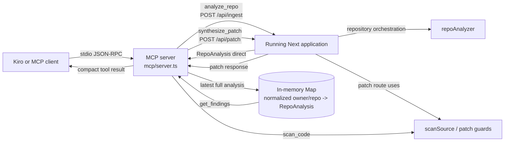

# Design: MCP Server Proxy

## Overview

The feature adds a stdio Model Context Protocol server at `mcp/server.ts`. It exposes exactly four read-or-propose tools:

- `analyze_repo`: proxy repository ingestion and return a compact triage summary.
- `get_findings`: read findings from the latest in-memory analysis for one normalized repository key and file path.
- `scan_code`: scan local or unpushed code using the existing `scanSource` contract.
- `synthesize_patch`: proxy guarded patch synthesis and report derived verification without applying changes.

The MCP server is intentionally a thin adapter. It does not clone repositories, implement analysis rules, implement a patch engine, mutate files, create branches, create pull requests, or open an HTTP/SSE MCP transport.

### Research findings that shape the design

- `POST /api/ingest` returns `RepoAnalysis` directly. It does not return an `ApiResponse` envelope. Its errors use the existing ingest error response contract.
- `POST /api/patch` scans the submitted file on the server, filters with `isPatchable`, applies guarded model edits, rescans the result, and returns `{ summary, patchedCode, provider, fixed, remaining }`.
- `scanSource(path, code)` in `src/lib/repoAnalyzer.ts` is the single-file scanner contract and returns static `RepoFinding` values. The MCP server must call or adapt this behavior rather than copy scanner rules.
- `RepoNode.findings` contains authoritative static findings and may also contain AI-derived observations. AI material must remain labeled unverified.
- The current `package.json` does not list `@modelcontextprotocol/sdk` or `zod`; implementation must verify or add those prerequisites in a later implementation task. This design does not modify package files.

## Architecture

The server has four small layers in one `mcp/server.ts` entry point, with pure helpers kept separable for testing:

1. **MCP transport and registration**: create the SDK `Server`, register exactly four tools, and connect `StdioServerTransport`.
2. **Input schemas**: Zod schemas enforce bounded strings and optional string arrays before any network, scanner, or cache operation.
3. **Proxy and domain adapters**: call the Next application, validate response shapes, project compact results, and map errors.
4. **Process-local cache**: store the latest successful full `RepoAnalysis` by the normalized lowercase `owner/repo` produced from `parseGitHubUrl()` in `src/lib/repoAnalyzer.ts`.

The base URL is `process.env.NECRO_API_URL?.trim() || 'http://localhost:3000'`. The server makes outbound `fetch` calls only to `/api/ingest` and `/api/patch`; `scan_code` remains local.



### Request lifecycle

- Tool arguments are validated before any side effect.
- Proxy responses are checked for HTTP success and expected JSON shape.
- A successful `analyze_repo` first validates the submitted repository URL with `parseGitHubUrl()`, then lowercases the parsed owner and repository to form the cache key, and replaces that normalized cache entry only after response validation succeeds.
- An invalid repository URL returns the existing invalid-URL tool error and does not read or write the cache.
- A failed analysis does not alter an existing successful cache entry.
- `get_findings` validates and normalizes its repository URL through `parseGitHubUrl()`, then reads only the latest successful analysis for that lowercase cache key and one matching node without calling Next.
- `scan_code` never needs a cache entry or Next application.
- `synthesize_patch` forwards only caller-supplied dependency/importer context and returns a proposal. It never applies the returned code.

## Components and Interfaces

### MCP server registration

Use the installed MCP SDK's stdio server APIs. The implementation must register exactly these names and no others:

```ts
const TOOL_NAMES = [
  'analyze_repo',
  'get_findings',
  'scan_code',
  'synthesize_patch',
] as const;
```

Each handler returns MCP-compatible structured content and a concise text fallback. Operational diagnostics use `console.error` only. No diagnostic goes to stdout because stdout is reserved for the stdio protocol.

### Tool schemas

The following schemas are the contract. Every string is trimmed and bounded before the handler runs. The exact maximums are implementation constants; they must be finite and documented in the server. Suggested limits are intentionally below the Next patch body limit where applicable.

```ts
const analyzeRepoSchema = z.object({
  repoUrl: z.string().trim().min(1).max(500),
}).strict();

const getFindingsSchema = z.object({
  repoUrl: z.string().trim().min(1).max(500),
  path: z.string().trim().min(1).max(500),
}).strict();

const scanCodeSchema = z.object({
  path: z.string().trim().min(1).max(500),
  code: z.string().min(1).max(100_000),
}).strict();

const synthesizePatchSchema = z.object({
  path: z.string().trim().min(1).max(500),
  code: z.string().min(1).max(100_000),
  dependencies: z.array(z.string().trim().min(1).max(200)).max(200).optional(),
  importedBy: z.array(z.string().trim().min(1).max(500)).max(20).optional(),
}).strict();
```

The schemas are exact per tool: unknown keys are rejected, `dependencies` and `importedBy` are optional only for `synthesize_patch`, and no `autoApprove` input field exists.

### `analyze_repo`

Input: `{ repoUrl: string }`.

Request:

```http
POST ${NECRO_API_URL}/api/ingest
Content-Type: application/json

{"repoUrl":"<submitted repoUrl>"}
```

The response is parsed as a direct `RepoAnalysis`. The submitted `repoUrl` is validated with `parseGitHubUrl()` from `src/lib/repoAnalyzer.ts`; its owner and repository are lowercased to form the cache key, so equivalent forms such as `owner/repo`, `github.com/owner/repo`, and `https://github.com/owner/repo` share one entry. Invalid URLs return the existing invalid-URL tool error without reading or writing the cache. A successful response replaces that key only after response-shape validation. The returned compact result is:

```ts
interface CompactAnalysis {
  title: string;
  defaultBranch: string;
  overallRot: number;
  rotSummary: string;
  coverage: RepoCoverage;
  files: Array<{
    path: string;
    score: number;
    findingCount: number;
  }>;
}
```

`files` is created from `analysis.nodes`, sorted by descending `rot` and deterministic path order, then sliced to at most 10. File entries contain only `path`, `score`, and `findingCount`. The result excludes `edges`, `code`, complete nodes, notes, recommendations, and repository contents.

### `get_findings`

Input: `{ repoUrl: string, path: string }`.

Lookup order:

1. Validate `repoUrl` with `parseGitHubUrl()` and lowercase the parsed owner and repository to form the cache key; invalid URLs return the existing invalid-URL tool error without reading the cache.
2. Find that normalized key in `analysisCache`; it contains only the latest successful analysis for that repository.
3. Find a node whose `path` exactly equals the submitted `path`.
4. Project only the node's findings.

```ts
interface CompactFinding {
  line: number | null;
  kind: string;
  text: string;
  suggestion: string;
  source: 'static' | 'ai-unverified';
}

interface FindingsResult {
  repoUrl: string;
  path: string;
  findings: CompactFinding[];
}
```

Static findings retain `source: 'static'` and are authoritative scanner results. AI findings or AI-derived observations are represented as `source: 'ai-unverified'`; they must never be presented as scanner-confirmed findings. The result excludes file code, notes, unrelated nodes, edges, and the full cached analysis.

If the normalized cache key has no entry, return an actionable error telling the caller to run `analyze_repo` first. If the key exists but the path does not, return a file-not-cached error without calling Next.

### `scan_code`

Input: `{ path: string, code: string }`.

Call the shared `scanSource(path, code)` function. Project every returned finding into:

```ts
interface ScanResult {
  path: string;
  findings: Array<{
    line: number | null;
    kind: string;
    text: string;
    suggestion: string;
    source: 'static';
  }>;
}
```

An empty scanner array is a successful result with `findings: []`. The MCP server must not add a scanner rule, change severity, reinterpret line numbers, or duplicate `repoAnalyzer.ts` logic.

### `synthesize_patch`

Input: `{ path, code, dependencies?, importedBy? }`.

Request:

```http
POST ${NECRO_API_URL}/api/patch
Content-Type: application/json

{
  "path": "<path>",
  "code": "<code>",
  "dependencies": ["<caller supplied dependency>"],
  "importedBy": ["<caller supplied importer>"]
}
```

Omit optional fields that the caller did not provide. The MCP layer does not send findings, select patchable kinds, or choose model targets. `/api/patch` remains responsible for scanning, `PATCHABLE_KINDS` filtering, edit validation, syntax checks, and second-scan verification.

The endpoint response must match:

```ts
interface PatchEndpointResponse {
  summary: string;
  patchedCode: string;
  provider: 'ai' | 'static-fallback';
  fixed: string[];
  remaining: string[];
}
```

The MCP result is:

```ts
interface PatchResult {
  summary: string;
  provider: 'ai' | 'static-fallback';
  edits: {
    changed: boolean;
    originalLength: number;
    patchedLength: number;
  };
  verification: {
    status: 'verified-change' | 'changed-with-remaining-findings' | 'no-change';
    changed: boolean;
    fixedCount: number;
    remainingCount: number;
    patchableFindingsRemain: boolean;
    aiOutputUnverified: boolean;
  };
  fixed: string[];
  remaining: string[];
  patchedCode?: string;
}
```

`edits.changed` is `patchedCode !== code`; the MCP server does not create a second diff or patch engine. When `verification.changed` is true, the result includes `patchedCode`; when it is false, the field is omitted. `verification` is derived only from `fixed`, `remaining`, `provider`, and the changed comparison. A changed response with fixed findings and no remaining findings is `verified-change`; a changed response with remaining findings is `changed-with-remaining-findings`; unchanged code is always `no-change`. The result remains proposal-only: the MCP server never writes files, creates branches or commits, or creates pull requests. Kiro applies a proposal only after user approval. AI output remains unverified until the endpoint's rescan evidence appears in `fixed` and `remaining`.

### Cache interface

```ts
type AnalysisCache = Map<string, RepoAnalysis>;

const analysisCache: AnalysisCache = new Map();
```

The cache key is formed by passing `repoUrl` to `parseGitHubUrl()` from `src/lib/repoAnalyzer.ts`, then lowercasing the parsed owner and repository as `owner/repo`. Thus `owner/repo`, `github.com/owner/repo`, and `https://github.com/owner/repo` share one entry. Invalid URLs return the existing invalid-URL tool error and do not read or write the cache. A successful refresh replaces the normalized value only after the full response validates. A failed refresh leaves the previous successful value untouched. No persistence, filesystem write, database, external cache, or cross-process sharing is introduced. Process exit discards the map.

### MCP configuration example

The implementation will register the server in `.kiro/settings/mcp.json` without adding another service:

```json
{
  "mcpServers": {
    "necro-docs": {
      "command": "npx",
      "args": ["tsx", "mcp/server.ts"],
      "cwd": "${workspaceFolder}",
      "env": {
        "NECRO_API_URL": "${NECRO_API_URL:-http://localhost:3000}"
      },
      "autoApprove": ["analyze_repo", "get_findings", "scan_code"]
    }
  }
}
```

The exact interpolation syntax may be adjusted to the consuming Kiro settings schema, but the semantic contract is fixed: `npx` runs `tsx mcp/server.ts` from the repository root, `NECRO_API_URL` is optional, and only `analyze_repo`, `get_findings`, and `scan_code` are auto-approved. `synthesize_patch` is not auto-approved and remains subject to user approval before Kiro applies it.

### Fixability and context extension (Requirements 12 to 14)

- `CompactFinding` gains `patchable: boolean`. `projectFinding` (get_findings) and `scanCode` (scan_code) compute it with `isPatchable()` from `@/lib/types`, which needs a full `RepoFinding`; `scanCode` therefore keeps the `RepoFinding` returned by `scanSource` and calls `isPatchable` on it before projecting. No kind list is copied.
- `CompactFile` gains `patchableCount`, counted with `isPatchable()` over `node.findings`.
- New pure helper `fileContext(analysis, node)` in `mcp/helpers.ts` returns `{ importedBy, imports }` (paths, max 20 each). `RepoEdge` is `{ from, to }` of node ids, where `from` imports `to` (confirmed by `conversion/helpers.ts`, which maps `from` to `source` and `to` to `target`, and by `page.tsx`, which treats edges whose `target` is the node as callers). `importedBy` = paths of `from` nodes for edges with `to === node.id`; `imports` = paths of `to` nodes for edges with `from === node.id`. Unknown ids are skipped.
- `FindingsResult` gains `importedBy` and `imports`. `node.code` is never returned.
- `synthesizePatchSchema` becomes a strict union of two shapes: `{ path, code, dependencies?, importedBy? }` and `{ repoUrl, path }`, so exactly one of `code` or `repoUrl` is accepted and mixed input is rejected. The raw shape for `registerTool` is the strict `z.union`.
- Handler flow for the `repoUrl` branch: normalize key, `findCachedNode` (existing errors), take `node.code`, `fileContext(...).importedBy` and `analysis.dependencies.slice(0, 200)`, run `scanSource(path, code).filter(isPatchable)`. If empty, return `{ message: 'No patchable findings in this file; nothing to patch.', patchable: 0 }` without `fetchPatch`. Otherwise call `fetchPatch` and `derivePatchResult` as before. The `code` branch keeps its current behavior and always calls `/api/patch`, which already reports no targets itself.
- Kiro layer: `.kiro/steering/necro-surgeon.md` (manual inclusion) and one `PostFileSave` agent hook; both are documentation and configuration, with no code in `src/`.

## Data Models

The server consumes the existing models rather than defining replacement analysis models:

- `RepoAnalysis`, `RepoNode`, `RepoCoverage`, and `RepoFinding` from `src/lib/repoAnalyzer.ts` and `src/lib/types.ts`.
- `RepoFinding.source === 'static'` is authoritative. `source === 'ai'` is adapted to `ai-unverified` at the MCP boundary.
- Patch response fields are the direct `/api/patch` contract: `summary`, `patchedCode`, `provider`, `fixed`, and `remaining`.
- The cache stores the complete `RepoAnalysis`, while tool responses expose only compact projections.

### Data-flow invariants

- No compact result contains full source code or the complete edge graph.
- No `get_findings` result contains data from another normalized repository key.
- No failed analysis replaces successful cached data.
- No scanner result is fabricated by the MCP layer.
- No patch result implies application or approval.

## Correctness Properties

*A property is a characteristic or behavior that should hold across all valid executions of a system—essentially, a formal statement about what the system should do. Properties bridge human-readable requirements and executable correctness guarantees.*

### Property 1: Validation precedes side effects

For any invalid tool input, schema validation returns a named validation error and performs zero proxy requests, scanner calls, or cache writes.

**Validates: Requirements 4.1, 4.2, 4.3, 4.4, 4.5, 4.6**

### Property 2: Compact analysis output is bounded and redacted

For any valid `RepoAnalysis`, the projected `analyze_repo` result contains at most 10 file entries sorted by descending rot score, each file entry contains only `path`, `score`, and `findingCount`, and the result contains neither full node code nor the complete edge graph.

**Validates: Requirements 5.1, 5.2, 5.3, 5.4, 5.5**

### Property 3: Cache refresh is isolated and failure-safe

For any normalized repository key and any sequence of successful or failed analyses, successful analyses replace only that key's latest successful value, failed analyses preserve its previous successful value, equivalent accepted URL forms share the same lowercase key, invalid URLs return the existing invalid-URL tool error without cache access, and a distinct normalized key can never satisfy its lookup.

**Validates: Requirements 5.1, 6.3, 6.4, 6.5, 9.1, 9.2, 9.3, 9.6**

### Property 4: Finding projection preserves authority labels

For any cached repository node, `get_findings` returns only `line`, `kind`, `text`, and `suggestion` plus an authority label, preserving static findings as authoritative and labeling AI-derived material as unverified without returning code or unrelated analysis.

**Validates: Requirements 6.1, 6.2, 6.6**

### Property 5: Scanner adapter has parity with the shared scanner

For any supported path and code string, `scan_code` returns the same finding kinds, lines, texts, suggestions, and static authority as `scanSource(path, code)`, including an explicit empty result when no findings exist.

**Validates: Requirements 7.1, 7.2, 7.3, 7.4, 7.5, 7.6**

### Property 6: Patch verification reflects the endpoint response

For any valid original code and valid `/api/patch` response, derived `verification.changed` equals `patchedCode !== originalCode`, fixed and remaining counts equal the endpoint arrays, `patchedCode` is present exactly when `verification.changed` is true, unchanged code always yields `no-change`, and the result never claims auto-approval or application.

**Validates: Requirements 8.3, 8.4, 8.5, 8.6, 8.7, 8.8**

The property-based tests use the installed `fast-check` library with at least 100 runs per property. Each test is tagged with a comment identifying the feature and the corresponding design property. Endpoint availability, inspector wiring, process lifetime, and error classification use example-based integration or smoke tests instead of generated network calls.

## Error Handling

All tool errors are returned as MCP tool errors with a concise actionable message. Diagnostic details go to stderr only, and messages must not contain tokens, keys, full source, full patch content, or request credentials.

| Condition | Mapping and caller action |
|---|---|
| Zod validation failure | `Invalid argument '<name>': <reason>`. Do not call Next, scanner, or cache. |
| Missing/empty repository URL | Preserve the ingest condition as `Repository URL is required`; ask for a valid URL. |
| Invalid URL format | `Repository URL is invalid: ...`; mention accepted GitHub URL/repository forms. |
| Non-GitHub repository | `Only github.com repositories are supported`. |
| Repository not found/private | `Repository was not found or is not accessible`. Never expose credentials. |
| GitHub rate limit | `GitHub rate limit exceeded; wait and retry later`. No indefinite retry. |
| GitHub/network/Next timeout or unavailable | `Cannot reach Next application at NECRO_API_URL; start the Next application or check NECRO_API_URL`. Preserve the actionable upstream condition when known. |
| Unexpected ingest shape | `Next returned an invalid analysis response`; do not cache or report success. |
| Missing cached URL | `No cached analysis for this repository; call analyze_repo first`. |
| Missing cached path | `File is not present in the latest cached analysis; use a path returned by analyze_repo`. No network request. |
| Unexpected patch shape | `Next returned an invalid patch response`; do not fabricate edits or verification. |
| Scanner exception | `Code scan failed: <safe error>`; do not leak source. |
| Patch unchanged/no accepted patch | Successful tool result with `verification.status: no-change`, with the endpoint summary/fixed/remaining preserved. |

The server catches startup failures and exits without printing operational text to stdout. Only the MCP SDK protocol may use stdout. `console.error` may include safe route/status context but must redact URL credentials and never include request bodies.

## Testing Strategy

### Unit and property tests

- Test each Zod schema with valid input, unknown keys, empty values, oversized values, and optional arrays.
- Mock `fetch` to assert `/api/ingest` receives `{ repoUrl }`, that `parseGitHubUrl()` followed by lowercasing produces the lowercase `owner/repo` cache key, and that the direct `RepoAnalysis` body is cached only after shape validation.
- Test compact ranking, field exclusion, finding authority projection, normalized cache transitions and equivalent URL forms, invalid-URL cache bypass, and patch verification derivation as pure helpers.
- Use `fast-check` for the six properties above, with at least 100 iterations for each property. Use fakes for network and scanner boundaries.
- Assert `scan_code` delegates to `scanSource` and preserves no-finding results.
- Assert `synthesize_patch` forwards only `path`, `code`, and caller-provided optional `dependencies`/`importedBy`; it never forwards `autoApprove` or client-supplied findings.

### Integration and error tests

- Fake the Next application for ingest success, malformed response, invalid URL, rate limit, unavailable service, patch success, unchanged patch, and malformed patch response.
- Verify failed refresh preserves the previous normalized cache entry, equivalent URL forms share the same lowercase key, invalid URLs return the existing invalid-URL error without cache access, and missing cache/path does not call `fetch`.
- Verify static findings are authoritative and AI-derived notes are labeled `ai-unverified` in MCP responses.
- Verify stdout has no diagnostics and safe error messages contain no token, source, or full patch content.

### MCP inspector smoke test

With the Next application running at `http://localhost:3000`, start the server from the repository root:

```powershell
npx tsx mcp/server.ts
```

In another terminal, inspect the stdio server:

```powershell
npx @modelcontextprotocol/inspector npx tsx mcp/server.ts
```

Confirm that the inspector sees exactly `analyze_repo`, `get_findings`, `scan_code`, and `synthesize_patch`; exercise representative valid and invalid schemas; run `analyze_repo` followed by `get_findings`; run `scan_code`; and run `synthesize_patch` against a fixture. Confirm the server opens no HTTP/SSE listener and that operational logs remain on stderr.

### Validation commands

The implementation phase should run the narrow tests first, then:

```powershell
npm test -- --run
npx tsc --noEmit
npm run build
```
