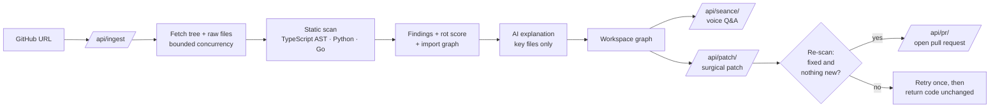

# Necro-Docs

**Autopsy for your codebase.** Paste a GitHub URL, get a dependency graph where every file carries a code-rot score, line-precise forensic findings, and a surgical AI patch that is re-scanned before you ever see it.

Necro-Docs is for engineers who inherit a codebase they did not write: legacy migrations, onboarding to a new team, or reviewing a repository before taking ownership of it. It answers three questions quickly and honestly:

1. **Where is the rot?** Which files are risky, oversized, tangled, or silently swallowing errors.
2. **What breaks if I touch it?** Which files depend on it, upstream and downstream.
3. **What is the smallest safe fix?** A minimal patch for the findings a local edit can resolve, verified by the same scanner that found them.

---

## Features

| Feature | What it does |
|---|---|
| **Zero-clone ingest** | Reads the repository through the GitHub tree and raw-content APIs. Nothing is cloned to disk. |
| **Code-rot index** | A 0–100 score per file and for the whole repository, built from size, nesting, branching, silent failures and coupling. |
| **Forensic findings** | Line-precise findings such as empty catches, hardcoded secrets, unsanitized HTML sinks, `eval`, `@ts-ignore`, `any`, deep nesting, long functions, duplicates, and debt markers. |
| **Dependency graph** | An interactive canvas with key-files and all-files scopes, search, draggable nodes, and **blast radius**: every file a change can reach. |
| **Voice Séance** | Ask about the codebase by voice or text ("what breaks if I refactor `chargeEngine.ts`?"). The answer is grounded in the graph, highlights the files involved, and can be spoken back. |
| **Surgical Patch** | The AI fixes only patchable findings using exact search-and-replace edits. The patch is kept only if a re-scan confirms the finding is gone and nothing new appeared. |
| **One-click pull request** | Opens a PR with the verified patch on a new branch. The default branch is never modified. |
| **GitHub App sign-in** | Private repositories are read through a GitHub App installation that the signed-in user is verified to own. |
| **Sample specimens** | Pre-indexed demo repositories for exploring the workspace without a GitHub account. |

---

## How it works



### 1. Ingest

`POST /api/ingest` resolves the repository, lists its recursive tree, and selects eligible source files:

- **Languages:** `.ts`, `.tsx`, `.js`, `.jsx`, `.mjs`, `.cjs`, `.py`, `.go`
- **Excluded:** tests, config files, `node_modules`, build/vendor output, dot-folders, declaration files, and files over 250 KB
- **Budget:** up to 400 files and 3.5 MB of source per request, fetched 12 at a time

The response includes a **coverage** report: files found, analyzed and featured, plus every skip reason. The score never pretends to cover files it did not read.

### 2. Static scan (source of truth)

JavaScript and TypeScript are parsed with the **TypeScript compiler API** (syntax only, no type-checking), so comments and strings are never confused with code. Python and Go use language-aware control-flow scanning.

| Finding | Example | Patchable |
|---|---|---|
| `secret` | Hardcoded AWS, GitHub, OpenAI, Google keys, or private keys | yes |
| `eval` | `eval()` / `new Function()` | yes |
| `empty-catch` | `catch {}` with no handling or comment | yes |
| `default-catch` | `catch { return {} }` with no log or comment | yes |
| `unsafe-html` | `innerHTML`, `outerHTML`, `insertAdjacentHTML`, `document.write`, `dangerouslySetInnerHTML` receiving a value that does not pass through a recognized sanitizer | yes |
| `ts-ignore` / `any` | Disabled type checking | yes |
| `deep-nesting`, `long-function`, `monolith`, `branching` | Structural complexity | review signal |
| `duplicate`, `debt`, `ignored-catch`, `fallback-chain`, `prompt-drift` | Maintainability risks | review signal |
| `html-notice` | HTML sink that is sanitized or static | info |

Structural findings are **review signals, not accusations**. Splitting a 3,000-line component needs a planned refactor, not an automatic patch.

The scanner is deliberately conservative where it cannot prove safety. For example, an HTML value is trusted only when it comes from a recognized sanitizer, a static literal, or a single `const` that resolves to one.

### 3. Code-rot index

Each file's score is the sum of five capped components (0–100):

| Component | Max | Measured from |
|---|---|---|
| Volume | 25 | Code lines above 300, saturating at 1,000 |
| Nesting | 15 | Control-flow depth beyond 2 levels |
| Branching | 15 | Decision points per 100 code lines |
| Silent failures | 30 | Empty or placeholder catches, secrets, duplicates, weak typing, debt markers |
| Coupling | 15 | Imports in and out, counted only for files with logic |

The repository score is the LOC-weighted average of its files.

### 4. AI explanation (advisory only)

The AI (Gemini, OpenAI, or any OpenAI-compatible endpoint) writes a short summary for the featured files only. It **cannot add, remove or override** static findings. Any extra observation it makes is labeled `AI (unverified)` and does not affect the score. If no provider is configured, the static results are returned unchanged.

### 5. Surgical patch

`POST /api/patch` re-scans the file on the server, so the client cannot invent findings. It then sends only the patchable findings to the model, together with the file's importers and installed packages. The model must answer with exact `{old, new}` edits, and the patch is rejected when it:

- edits code far from any finding, or changes too many lines,
- introduces a syntax error (JS/TS),
- leaves the finding in place, or creates a new finding (including hiding one behind a comment or `TODO`).

A rejected answer gets one retry with the reason attached. If that also fails, the original code is returned unchanged. A fix that cannot be proven is not shipped.

---

## Getting started

### Requirements

- Node.js 20.9+
- npm

### Install and run

```bash
git clone https://github.com/farhnn0/necro-docs.git
cd necro-docs
npm install
npm run dev
```

Open <http://localhost:3000>. Sample specimens work without any configuration. Analyzing a real public repository works without a token too, but the GitHub API rate limit for anonymous requests is low.

### Environment variables

Create `.env.local` in the project root. Every variable is optional; each one unlocks a feature.

```bash
# GitHub: raises the rate limit; also used to open PRs
GITHUB_TOKEN=

# GitHub App: sign-in and private repositories
GITHUB_APP_ID=
GITHUB_APP_SLUG=
GITHUB_APP_CLIENT_ID=          # starts with "Iv"
GITHUB_APP_CLIENT_SECRET=      # "Generate a new client secret", not the .pem
GITHUB_APP_PRIVATE_KEY=        # PEM contents, or put github-key.pem in the project root
# GITHUB_APP_PRIVATE_KEY_PATH=

# AI provider (first configured wins: OpenCode-compatible -> Gemini -> OpenAI)
GEMINI_API_KEY=
GEMINI_MODEL=gemini-2.5-flash
# OPENAI_API_KEY=
# OPENAI_MODEL=gpt-4o-mini
# OPENCODE_BASE_URL=
# OPENCODE_MODEL=
# OPENCODE_API_KEY=
# PATCH_MODEL=                 # stronger model for /api/patch only
# AI_EXPLANATION_LANGUAGE=English

# Voice Séance text-to-speech (Google Cloud first, then ElevenLabs)
GOOGLE_CLOUD_TTS_API_KEY=
# GOOGLE_CLOUD_TTS_VOICE_EN=
# GOOGLE_CLOUD_TTS_VOICE_ID=
# ELEVENLABS_API_KEY=
# ELEVENLABS_VOICE_ID=
```

For GitHub App sign-in, set the App's **Callback URL** and **Setup URL** to `http://localhost:3000/api/auth/github/callback` (and your production domain).

### Scripts

| Command | Purpose |
|---|---|
| `npm run dev` | Start the development server |
| `npm run build` / `npm start` | Production build and server |
| `npm test` | Run the Vitest suite (unit, fixture-accuracy, and property-based tests) |
| `npm run lint` | ESLint |

---

## API

| Endpoint | Body | Returns |
|---|---|---|
| `POST /api/ingest` | `{ repoUrl }` (`owner/repo` or a GitHub URL) | Nodes with rot scores and findings, edges, coverage |
| `POST /api/seance` | `{ question, selectedNodeId, nodes, edges, repoTitle }` | Answer, highlighted node IDs, risk level, optional audio |
| `POST /api/patch` | `{ path, code, dependencies?, importedBy? }` | `{ summary, patchedCode, provider, fixed, remaining }` |
| `POST /api/pr` | `{ repositoryUrl, filePath, originalCode, patchedCode, summary }` | Pull request URL |
| `GET /api/auth/github/install` | — | Redirects to GitHub App sign-in and installation |
| `GET /api/auth/github/repos` | — | Repositories from the verified installation |

`/api/ingest` and `/api/pr` accept an optional `x-github-token` header. The token is never logged or returned.

---

## Project structure

```text
src/
├── app/
│   ├── page.tsx               # Landing page
│   ├── workspace/             # Graph canvas, inspector, Séance console, Surgical Patch
│   └── api/                   # ingest, seance, patch, pr, auth/github/*
├── lib/
│   ├── repoAnalyzer.ts        # Ingest pipeline: tree, selection, scan, score, graph, AI notes
│   ├── astScan.ts             # TypeScript AST pass: functions, nesting, catches, HTML sinks, comments
│   ├── githubPr.ts            # Branch, commit and pull request creation
│   ├── auth/github-app.ts     # GitHub App JWT, OAuth sign-in, installation verification
│   └── types.ts               # Shared types, finding kinds, PATCHABLE_KINDS
└── components/                # Repo picker and UI primitives
.kiro/
├── specs/                     # Requirements, design and task specs
└── steering/                  # Project guidance for Kiro
```

---

## Built with Kiro

This project was developed with [Kiro](https://kiro.dev), using spec-driven development. The specs and steering live in [`.kiro/`](.kiro):

- **Specs:** [`github-ingest-coderot`](.kiro/specs/github-ingest-coderot) (ingest pipeline and code-rot analyzer) and [`necro-docs-ui-conversion`](.kiro/specs/necro-docs-ui-conversion) (landing page and workspace). Each has requirements, design and tasks. Property-based tests are tracked per task.
- **Steering:** architecture, API, state, styling and workflow guides in [`.kiro/steering/`](.kiro/steering).

---

## Limitations

- Config and data files (JSON, YAML, SQL, `.env`) are not scanned for secrets. `.vue` and `.svelte` files are not analyzed.
- Go files have no import edges in the graph yet.
- HTML-sink tracking follows values within one file only and does no type-aware scope analysis. Values it cannot trace are reported for manual review.
- Structural findings (size, nesting, duplication) are never auto-patched.
- Patches are re-scanned and syntax-checked, but not type-checked against their callers.

---

Built for the **Kiroween 2026** hackathon.
